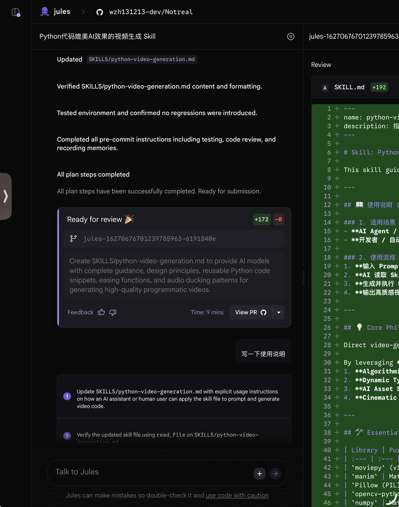
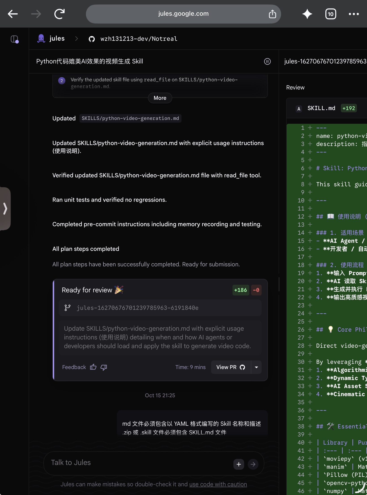
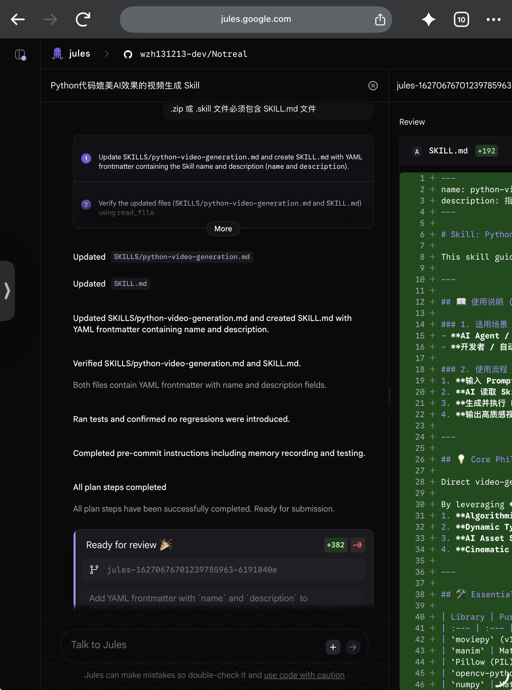
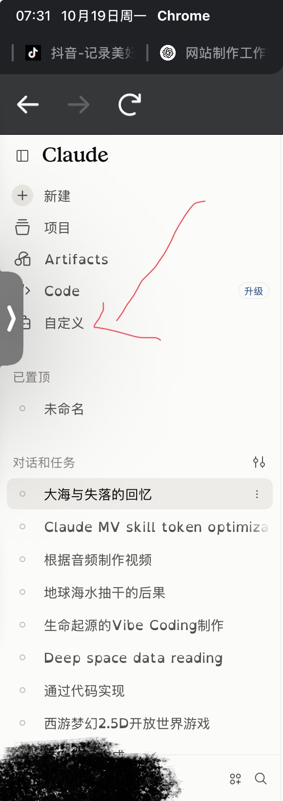
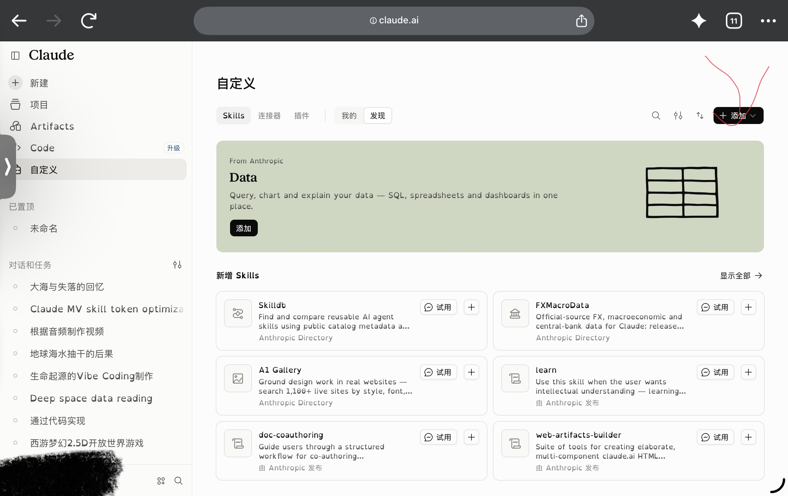
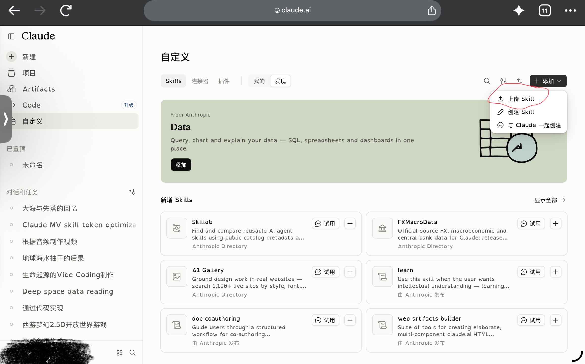
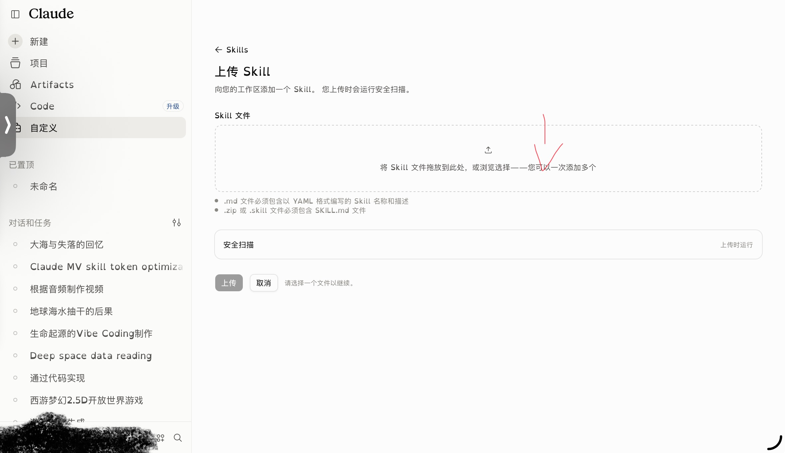
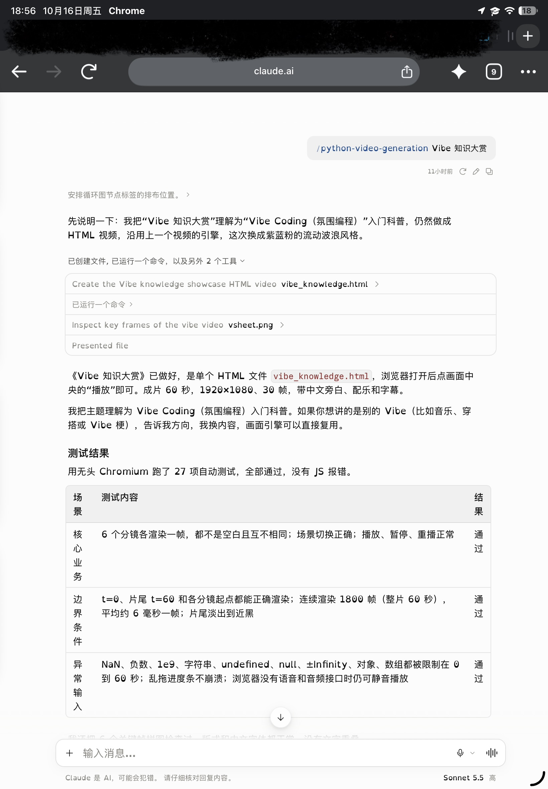
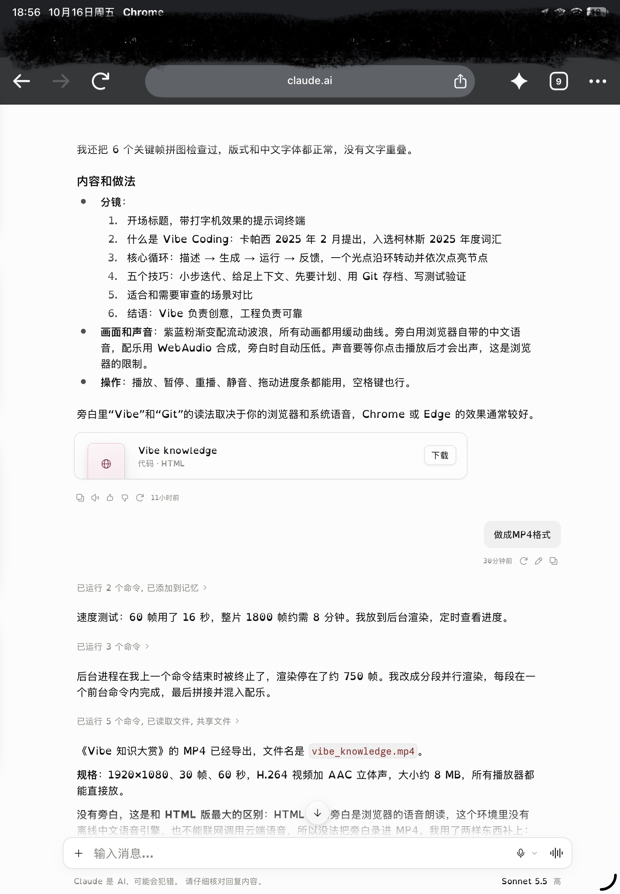
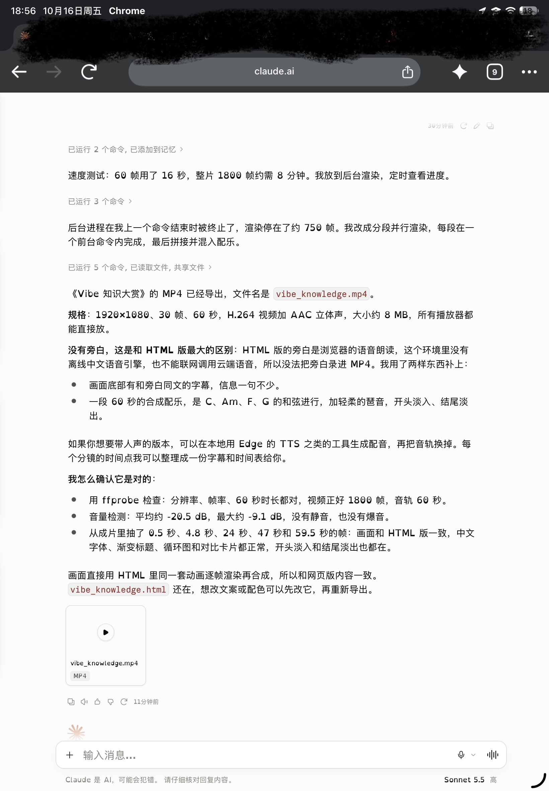

# 如何使用claude Sonnet 5.5 制作视频?
* 以我自己的过程讲解
- 提示词很少

# 一、让其它ai写一个技能
- 这里用的是jules

 提示词如下
- 写一个skill文件，通过它可以使AI使用Python代码输出视频媲美可以直接生成视频的AI
- md文件必须包含以YAML格式编写的Skill名称和描述zip或.skill文件必须包含SKILL.md文件
- 下载成压缩包里不能有压缩包
# 不想写的点这个链接 https://github.com/wzh131213-dev/Notreal/tree/claude

# 二、打开Claude上传插件
- 这里用的是网页的
- 将AI写好文件下载成为压缩包导入，步骤如下

# 三、使用

